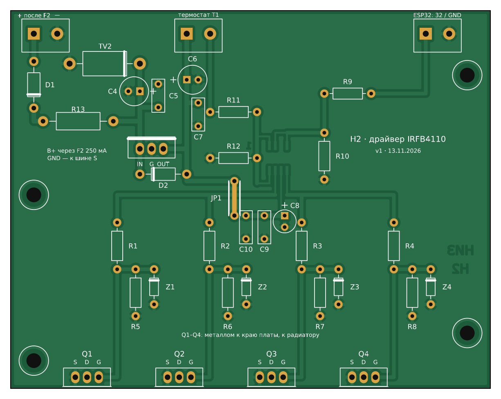

# Плата драйвера 4 × IRFB4110 (H2 PRO)

Печатная плата управления силовым ключом электролизёра: драйвер UCC27524, питание 12 В (L7812),
обвязка затворов Q1–Q4, клеммники для питания, термостата и сигнала ESP32 (GPIO32).
Силовой ток через плату не идёт — провода 4 мм² паяются прямо к ножкам D и S.

| Файл | Зачем |
|---|---|
| [`вывод/h2_driver_gerber.zip`](вывод/h2_driver_gerber.zip) | Gerber для заказа на заводе: 2 слоя, 1,6 мм, 1 oz, 104 × 82 мм |
| [`вывод/ЛУТ_нижний_слой_1-1.pdf`](вывод/ЛУТ_нижний_слой_1-1.pdf) | Шаблон для ЛУТ, печать 100 % |
| [`вывод/Сборка_расположение_деталей.pdf`](вывод/Сборка_расположение_деталей.pdf) | Куда какие детали, 1:1 |
| [`вывод/вид_медь_низ.png`](вывод/вид_медь_низ.png) | Нижний слой меди |
| [`ПРОЧТИ.txt`](ПРОЧТИ.txt) | Заказ, ЛУТ и порядок сборки |
| [`make_pcb.py`](make_pcb.py), [`pcb_output.py`](pcb_output.py) | Генератор платы и автопроверки |

## Автопроверки (`py -3 make_pcb.py`)
- цепи платы совпадают со схемой `../IRFB4110_фотомонтаж/overall-connections.json`;
- зазор между цепями ≥ 0,5 мм, до края ≥ 0,7 мм, каждая цепь связна;
- корпуса деталей не налезают друг на друга, на чужие площадки и на винты крепления.

Нужно: Python 3, `shapely`, `matplotlib`; для проверки Gerber — `gerbonara`.
